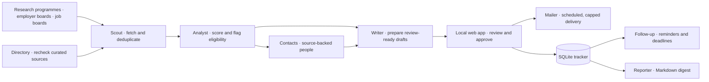

# 📡 Internship Radar

### An evidence-first assistant for finding and managing final-year internships

Search research programmes and employer boards, rank relevant roles against a profile, collect source-backed contacts, prepare application drafts, and track follow-ups in a local web app.

* * *

## The problem

Internship listings are spread across employer sites, research programmes, and job boards. A promising title can still be the wrong location, timing, contract type, or eligibility fit. Keeping track of sources, contacts, and follow-ups takes time away from applying.

Internship Radar brings discovery and application tracking into one place. Each result links to its source, shows why it scored as it did, and highlights eligibility details to review before applying.

## Why this project is worth a look

| Area | What it does |
| --- | --- |
| Broad discovery | Checks research programmes and about 190 employer boards through public Greenhouse, Lever, Ashby, SmartRecruiters, and Workday endpoints, plus selected job boards. Includes a dynamic source registry with enable/disable toggles, error categorisation, and custom ATS board support. |
| Explainable ranking | Shows six score components and the eligibility rules that changed the result. |
| Evidence-backed contacts | Keeps the page or publication that supports each contact, with confidence scoring, role verification, and timestamped evidence; it does not guess e-mail addresses. |
| Document library | Local-only library for multiple CV versions, transcripts, certificates, and cover letters. Per-application document selection with dynamic attachment phrasing and size limits. |
| Review before sending | Builds application drafts for approval. Nothing is sent until a specific draft is approved. |
| Local-first storage | Keeps the tracker, document library, profile, and generated digests on the machine running the app. |
| Optional AI | Gemini can add a second opinion and polish drafts; built-in ranking and templates work without it. |

* * *

## 🏗️ Architecture



## 🔎 Discovery pipeline

| Agent | Responsibility |
| --- | --- |
| Scout | Reads supported sources with per-site spacing, stops when a site refuses access, and deduplicates repeated postings. |
| Analyst | Scores offers, adds an optional Gemini review, and flags contract, language, visa, nationality, clearance, and other eligibility constraints. |
| Contacts | Collects named supervisors and researchers with a source page or publication attached, then looks for addresses published by those sources. |
| Directory | Rechecks the curated institutions, programmes, and employers so stale links are visible. |
| Writer | Prepares French or English drafts from the profile and facts provided by the candidate. |
| Follow-up | Marks applications with no reply after the configured interval and watches deadlines. |
| Reporter | Writes a dated Markdown digest under `data/digests/`. |

### Sources

- **Research institutes and programmes** — Inria, CEA, FBK, BSC, KAUST VSRP.
- **Schools and labs** — Institut Mines-Télécom board (Télécom SudParis, Télécom Paris, IMT schools), IBISC (Université d'Évry Paris-Saclay), LISN (Paris-Saclay), Télécom Paris Data & AI internships, the CNRS GdR IASIS national internship board, the SFdS job board, and ATIEF. PDF subjects are read, and supervisors named in them become contacts.
- **Employer boards** — Greenhouse, Lever, Ashby, SmartRecruiters, Workday and Recruitee endpoints for ~190 employers.
- **Job boards** — HelloWork, Arbeitnow, Tanqeeb (Egypt and the Gulf), Amazon, and LinkedIn's public job search.
- **Your own additions** — in **Agents → Add a source**, paste a lab or school internship page, an RSS feed, a WordPress lab site, or a Recruitee/Greenhouse/Lever/Ashby/Workday board ID. New sources are filtered to internships in your field like the built-in ones.

LinkedIn is read through the public job search that anyone can open without signing in, at one request every 3 seconds, and the scan stops at the first refusal. Your LinkedIn account is never used. Welcome to the Jungle, Indeed, JobTeaser, Wuzzuf, Bayt, GulfTalent and the Paris-Saclay internship catalogue (university network only) are offered as pre-filled searches in **Launchpad**.

### Pay

Every offer shows its pay ("gratification", salary or stipend) normalised to euros per month: from a structured salary field when the board publishes one, otherwise from the posting text (French, English, German and Italian phrasing, hourly/monthly/yearly, other currencies converted approximately). Perks quoted per month (meal vouchers, transport, tool budgets) are not counted. French offers that state nothing show the legal minimum gratification, labelled as such. **Today** summarises stated pay per region, and offers can be filtered and sorted by pay.

### Where people work

Each researcher gets a city and, in France, a region, read from their institution, lab, e-mail domain and paper affiliations (never guessed). **Researchers** filters by country, region and city, and **Nice · Côte d'Azur** shows everyone in Nice, Sophia Antipolis, Antibes, Valbonne, Biot, Cannes and Monaco. **Find more researchers around Nice** searches OpenAlex for the last and corresponding authors of recent AI papers from Université Côte d'Azur, EURECOM, Inria, I3S and the Observatoire de la Côte d'Azur, then looks up only the addresses they published.

### Lighter attachments

Scanned documents are re-saved at 200 dpi when added (above 1.5 MB), so each e-mail stays around 2 MB instead of 12 MB, which matters because every sent e-mail counts against the Google storage quota. **Settings → Documents** shows how much each e-mail carries and has **Compress** and **Original** buttons; originals are kept in `data/documents/originals`.

### Adding someone yourself

**Researchers → + Add a researcher** (also **+ Add someone** in Session) adds a person you found yourself. Paste an e-mail signature or a few lines of their web page and the name, address, lab, university, page and form of address fill themselves; nothing is guessed from the address. The country decides French or English (it is detected from the institution when left empty), and the research topics go into the e-mail. **Paste a list** adds several people at once, one per line (name and e-mail, optionally institution and country, separated by commas, semicolons or tabs). People added this way are marked *Added by you*, are never added twice, come first when e-mails are prepared, and their e-mail waits in Session for your approval like the others.

### Your own researcher list

**People → Import a researcher list (.xlsx)** loads a spreadsheet with at least a name and an e-mail column; laboratory, university, country, research areas, profile link, status, sent/follow-up/reply dates and notes are read when present. Outreach history is kept: people marked sent, replied or rejected show as *already contacted*, *replied* or *declined*, and drafting to them asks for confirmation first.

Each listed researcher is then matched to their OpenAlex publication profile (the country or lab must agree with the name). **Find similar researchers** builds the list's research profile from the topics those people publish on and looks for other active researchers in your target regions with the same profile — quotas follow your region priorities, the affiliation must recur over at least two recent years, and company labs are skipped. Each match names the researcher on your list it resembles and the shared topics; addresses are added only when the person published them (ORCID or their own arXiv papers). The search reruns with the Contacts agent every week.

Without an API key OpenAlex allows about 100 searches a day per network; setting `OPENALEX_API_KEY` (free at openalex.org/settings/api) raises that tenfold.

## 📊 Ranking model

Each offer gets a score out of 100, with the components shown on its card:

| Component | Maximum |
| --- | ---: |
| Domain fit | 45 |
| Internship type | 12 |
| Location priority | 20 |
| Timing | 8 |
| Skills overlap | 10 |
| Language | 5 |

Eligibility issues subtract points and appear under **Check before applying**. Grades are A (85+), B (72–84), and C (58–71). Priorities and score settings can be edited in the app.

## 📄 Document library & per-application selection

The application includes a local document library (`data/documents/`) supporting:
- Multiple CV versions (e.g. general vs. research/specialized), transcripts, recommendation letters, references, language-test results, certificates, portfolios and cover letters (PDF, Word, PNG or JPEG).
- **Send by default**: one default CV per language, plus any number of other documents (a transcript, a recommendation letter…) attached to every new application in their language; each application can still add or remove documents before approval.
- Metadata tracking: document type, target language (FR, EN, ALL, OTHER), version/date, notes, and default selection flags.
- Strict security: path traversal sanitization, supported extension validation (`.pdf`, `.docx`, `.doc`), 15 MB per-file limit, and an 18 MB total attachment limit (Gmail's 25 MB limit applies after encoding).
- Per-application document selector: choose exact attachments per draft before approval. By default, the matching language CV is pre-selected; transcripts and certificates are never attached unless explicitly chosen.
- Document-aware draft text: email body closing statements automatically adapt to the exact selected attachments (e.g. "mon CV et mes relevés de notes sont en pièces jointes" vs. "mon CV ci-joint").

## ✉️ Application workflow

The app is built around a **review session** twice a week (the days are chosen in Settings). Between sessions the Radar scans, prepares drafts and watches for replies; the session is where you decide.

**Session** lists what needs you, top to bottom:

1. **Replies** found in your mailbox, sorted by tone (positive, would host without funding, redirect, to read); replies that look like a refusal are folded and can be filed in one click.
2. **Problems** — bounced addresses and failed sends.
3. **Follow-ups** due for people who have not answered.
4. **New e-mails to approve** — tick many, approve in one click. Sends are spaced out, wait the configured delay and respect the daily cap.
5. **Addresses to verify** — anything your own notes flag as guessed is held back until you confirm it.
6. **Best offers** to apply to on the employer's site, each with an **application kit** (posting link, tailored letter to copy or download, the right files, "I applied" button that sets a reminder).

**Outreach** shows every e-mail by stage (to approve, scheduled, waiting, follow-up due, replied, interview, closed) with the same multi-select bar. **Researchers** is the list of people to write to — tick several and prepare their e-mails together. **Offers** hides grade C/D and offers with an eligibility blocker by default.

Nothing is sent without your tick. The researcher e-mail follows one fixed template (French or English according to where the person works) and only states facts from your profile.

### Replies and notifications

With the mailbox option on, the Radar signs in over IMAP (read-only, nothing is marked as read) and opens only messages from addresses you wrote to, plus delivery-failure notices. A reply stops the pending follow-up. You get an e-mail when a reply arrives, an address bounces or a shortlisted offer closes within a week, and a short summary on the morning of each review day.

### Connecting a mailbox

Mailboxes are connected with **Connect with Google** (OAuth 2.0 with PKCE). Sending and reading go through the Gmail API over HTTPS, so networks that block mail ports do not matter. School Google accounts work too when app passwords are switched off — unless the school administrator blocks third-party apps.

Because the Radar runs on your own computer, Google needs an OAuth client from your own Google Cloud project, created once:

1. Create a project at console.cloud.google.com and enable the **Gmail API**.
2. In **Google Auth Platform**, choose audience **External**, then **Publish app** (in "Testing" mode Google withdraws the permission every 7 days).
3. Under **Clients**, create a client of type **Desktop app** and download its JSON file.
4. In **Settings → E-mail sending**, load the file, then click **Connect with Google** next to each address. Google warns that the app is unverified; that is expected for an app only you use.

Sending needs only the `gmail.send` permission; reading replies (`gmail.readonly`) is optional. Refresh tokens, the client secret and any app passwords are stored encrypted with Windows DPAPI for the current Windows user. App passwords (SMTP/IMAP) remain available as a fallback.

## 🔒 Personal data and credentials

The public repository contains code and source registries. The root `data/` folder, `data/documents/`, SQLite databases, CVs, transcripts, certificates, generated digests, virtual environments, and `radar/local_profile.py` are excluded by `.gitignore`. A fresh clone starts with blank profile and sender fields; add your own details in the app.

Set `GEMINI_API_KEY` in the environment to enable Gemini. Without it, the local ranking and templates remain available. Override the model with `GEMINI_MODEL`.

* * *

## 🚀 Running it

Python 3.10+ on Windows is recommended. Windows Task Scheduler and DPAPI are used for scheduled runs and mailbox credential storage.

```powershell
python -m venv venv
.\venv\Scripts\python.exe -m pip install -r requirements.txt
.\venv\Scripts\python.exe radar.py
```

The local app opens at `http://127.0.0.1:8765`. Keep the terminal window open while using it.

### Commands

```powershell
.\venv\Scripts\python.exe radar.py run
.\venv\Scripts\python.exe radar.py run --agents scout,analyst --sources inria,cea,eurecom
.\venv\Scripts\python.exe radar.py status
.\venv\Scripts\python.exe radar.py schedule
.\venv\Scripts\python.exe radar.py schedule --remove
```

`schedule` installs two Windows tasks: a daily scan at 07:30, and a heartbeat every 15 minutes (`radar.py send-due`) that sends approved e-mails that are due, checks the mailbox for replies, sends notifications and catches up on a scan missed while the computer was off. While the app is open, agents also refresh every 12 hours. These intervals can be changed in the app.

* * *

## 📁 Project structure

```text
radar.py                 command-line entry point
radar/config.py          paths, environment settings, and blank profile defaults
radar/pipeline.py        agent orchestration
radar/scoring.py         explainable fit score
radar/documents.py       document library, storage validation, and attachment resolution
radar/sources/           research, job-board, and ATS connectors + SQLite source registry
radar/contacts.py        contact discovery, role verification, and evidence checks
radar/writer.py          drafts, document-aware attachments, Gemini integration, .eml export
radar/mailer.py          approval, scheduling, attachment assembly, and mail delivery
radar/workflow.py        review session, batch approval, outreach preparation, application kits
radar/google_mail.py     "Connect with Google": OAuth sign-in, Gmail API sending and reading
radar/inbox.py           read-only reply and bounce detection (Gmail API or IMAP)
radar/notify.py          e-mails to yourself: replies, bounces, deadlines, session summary
radar/outreach.py        researcher e-mail template and language choice
radar/researchers.py     spreadsheet import and similar-researcher search (OpenAlex)
radar/server.py          local API bound to 127.0.0.1
radar/web/               browser interface (single-page app)
radar/data/              employer boards and curated source registry
requirements.txt         Python dependencies
tests/                   regression tests (test_core, test_mailer, test_features)
```

## 🛠️ Stack

Python · SQLite · Requests · lxml · fpdf2 · Gemini API (optional) · HTML · CSS · JavaScript

## 🔬 Known limitations

- Coverage depends on each source's public endpoint and can change when a site changes its board.
- Some job sites do not allow automated reading; the app opens targeted searches for those sources instead.
- LinkedIn's public search can stop answering for a while; the scan then skips it until the next run.
- Pay is only as good as the posting: most offers state no amount, and converted currencies are approximate.
- Contact discovery only finds people and e-mail addresses that can be tied to a retained source.
- Gemini is optional and may be unavailable; core ranking and draft templates do not depend on it.

* * *

Built by [ZakiANK04](https://github.com/ZakiANK04)
