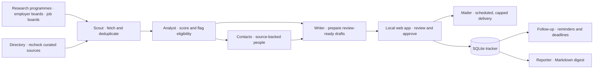

# 📡 Internship Radar

### An evidence-first assistant for finding and managing final-year internships

Search research programmes and employer boards, rank relevant roles against a profile, collect source-backed contacts, prepare application drafts, and track follow-ups in a local web app.

* * *

## The problem

Internship listings are spread across employer sites, research programmes, and job boards. A promising title can still be the wrong location, timing, contract type, or eligibility fit. Keeping track of sources, contacts, and follow-ups takes time away from applying.

Internship Radar brings discovery and application tracking into one place. Each result links to its source, shows why it scored as it did, and highlights eligibility details to review before applying.

## Why this project is worth a look

| Area | What it does |
| --- | --- |
| Broad discovery | Checks research programmes and about 190 employer boards through public Greenhouse, Lever, Ashby, SmartRecruiters, and Workday endpoints, plus selected job boards. |
| Explainable ranking | Shows six score components and the eligibility rules that changed the result. |
| Evidence-backed contacts | Keeps the page or publication that supports each contact; it does not guess e-mail addresses. |
| Review before sending | Builds application drafts for approval. Nothing is sent until a specific draft is approved. |
| Local-first storage | Keeps the tracker, profile, and generated digests on the machine running the app. |
| Optional AI | Gemini can add a second opinion and polish drafts; built-in ranking and templates work without it. |

* * *

## 🏗️ Architecture



## 🔎 Discovery pipeline

| Agent | Responsibility |
| --- | --- |
| Scout | Reads supported sources with per-site spacing, stops when a site refuses access, and deduplicates repeated postings. |
| Analyst | Scores offers, adds an optional Gemini review, and flags contract, language, visa, nationality, clearance, and other eligibility constraints. |
| Contacts | Collects named supervisors and researchers with a source page or publication attached, then looks for addresses published by those sources. |
| Directory | Rechecks the curated institutions, programmes, and employers so stale links are visible. |
| Writer | Prepares French or English drafts from the profile and facts provided by the candidate. |
| Follow-up | Marks applications with no reply after the configured interval and watches deadlines. |
| Reporter | Writes a dated Markdown digest under `data/digests/`. |

LinkedIn, Welcome to the Jungle, Indeed, JobTeaser, Wuzzuf, Bayt, and GulfTalent are offered as pre-filled searches. The app does not scrape those sites.

## 📊 Ranking model

Each offer gets a score out of 100, with the components shown on its card:

| Component | Maximum |
| --- | ---: |
| Domain fit | 45 |
| Internship type | 12 |
| Location priority | 20 |
| Timing | 8 |
| Skills overlap | 10 |
| Language | 5 |

Eligibility issues subtract points and appear under **Check before applying**. Grades are A (85+), B (72–84), and C (58–71). Priorities and score settings can be edited in the app.

## ✉️ Application workflow

1. Review the offer, evidence, recipient, and draft in **Pipeline**.
2. Approve that specific message to schedule it for delivery after the configured delay.
3. The sender observes a daily cap and reports failures instead of retrying blindly.

Mailbox passwords are stored with Windows DPAPI for the current Windows user. Configure mail accounts in **Profile & priorities → E-mail sending**. The app does not send an application without your approval.

## 🔒 Personal data and credentials

The public repository contains code and source registries. The root `data/` folder, SQLite databases, CVs, transcripts, certificates, generated digests, virtual environments, and `radar/local_profile.py` are excluded by `.gitignore`. A fresh clone starts with blank profile and sender fields; add your own details in the app.

Set `GEMINI_API_KEY` in the environment to enable Gemini. Without it, the local ranking and templates remain available. Override the model with `GEMINI_MODEL`.

* * *

## 🚀 Running it

Python 3.10+ on Windows is recommended. Windows Task Scheduler and DPAPI are used for scheduled runs and mailbox credential storage.

```powershell
python -m venv venv
.\venv\Scripts\python.exe -m pip install -r requirements.txt
.\venv\Scripts\python.exe radar.py
```

The local app opens at `http://127.0.0.1:8765`. Keep the terminal window open while using it.

### Commands

```powershell
.\venv\Scripts\python.exe radar.py run
.\venv\Scripts\python.exe radar.py run --agents scout,analyst --sources inria,cea
.\venv\Scripts\python.exe radar.py status
.\venv\Scripts\python.exe radar.py schedule
.\venv\Scripts\python.exe radar.py schedule --remove
```

The scheduler runs daily at 07:30 by default. While the app is open, agents refresh every 12 hours. These intervals can be changed in the app.

* * *

## 📁 Project structure

```text
radar.py                 command-line entry point
radar/config.py          paths, environment settings, and blank profile defaults
radar/pipeline.py        agent orchestration
radar/scoring.py         explainable fit score
radar/sources/           research, job-board, and ATS connectors
radar/contacts.py        contact discovery and evidence checks
radar/writer.py          drafts, Gemini integration, and .eml export
radar/mailer.py          approval, scheduling, and mail delivery
radar/server.py          local API bound to 127.0.0.1
radar/web/               browser interface
radar/data/              employer boards and curated source registry
requirements.txt         Python dependencies
tests/                   regression tests
```

## 🛠️ Stack

Python · SQLite · Requests · lxml · fpdf2 · Gemini API (optional) · HTML · CSS · JavaScript

## 🔬 Known limitations

- Coverage depends on each source's public endpoint and can change when a site changes its board.
- Some job sites do not allow automated reading; the app opens targeted searches for those sources instead.
- Contact discovery only finds people and e-mail addresses that can be tied to a retained source.
- Gemini is optional and may be unavailable; core ranking and draft templates do not depend on it.

* * *

Built by [ZakiANK04](https://github.com/ZakiANK04)
